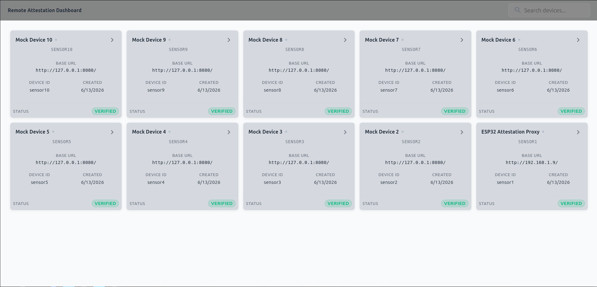
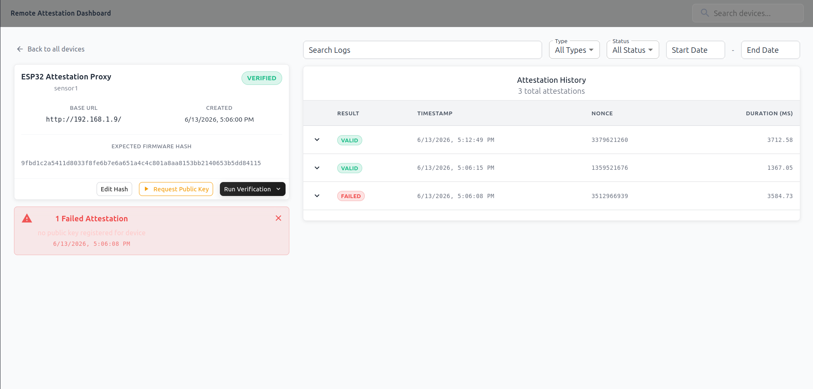
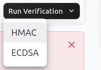
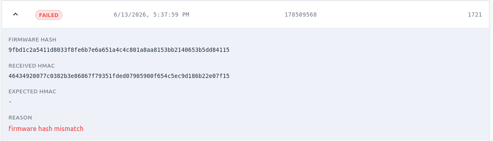
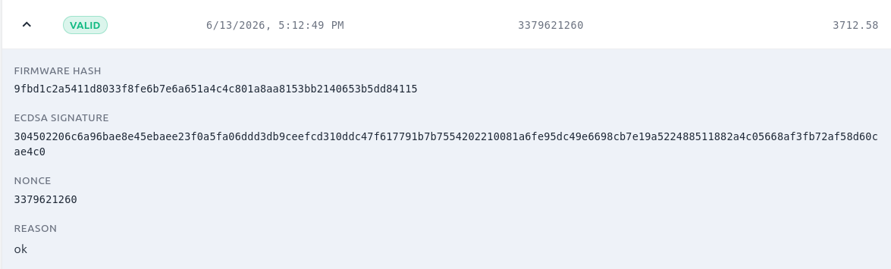

# Remote Attestation Service for Embedded Systems Based on ARM TrustZone-M

Diploma thesis project, Babeș-Bolyai University of Cluj-Napoca, Faculty of Mathematics and Informatics (2026).
Advisor: András Libál, PhD. Author: Csongor Nagy.
📄 [Full thesis (PDF, Hungarian, with English and Romanian abstract)](docs/thesis.pdf)

The project was also presented at the Transylvanian Scientific Students' Conference (ETDK), where it placed second.

## Abstract

This thesis presents the design and implementation of a remote attestation service for embedded systems based on ARM TrustZone-M technology running on an STM32U5 microcontroller. The attestation mechanism enables an external verifier to assess the firmware integrity of an IoT device, guaranteeing that the device runs an untampered and trusted software image.

The system leverages the hardware-enforced separation provided by TrustZone-M, which partitions the processor into a Secure World (Secure Enclave) and a Non-Secure World. The Secure World implements the core attestation engine, computing a cryptographic SHA-256 measurement of the Non-Secure firmware directly from memory. This measurement is performed entirely within the Secure Enclave, ensuring that potentially compromised Non-Secure software cannot falsify the attestation result.

To provide versatile security profiles that balance maximum cryptographic assurance with fast, energy-efficient execution, the architecture supports a dual-mode authentication: a low-latency symmetric HMAC-SHA256 path and a highly secure asymmetric ECDSA-SHA256 path using the SECP256R1 elliptic curve. Asymmetric operations and secure random number generation are handled via the integration of the Mbed TLS cryptographic library inside the Secure World.

Communication between the microcontroller and the remote verifier is bridged via an external network proxy (an ESP32 proxy). In future improvements this will be done on the microcontroller itself. The remote Flask backend validates the received attestation response using either a shared symmetric key or a pre-provisioned public key.

Performance benchmarks reflect the realistic computational costs associated with embedded cryptographic operations. The symmetric HMAC attestation path executes with a latency of 1.75 to 1.9 seconds, optimized directly by the hardware hash peripheral. The asymmetric ECDSA signing path, heavily reliant on complex big-integer modular arithmetic on the elliptic curve, completes within 3.1 to 3.5 seconds. The proposed architecture successfully demonstrates how modern microcontrollers with TrustZone-M support can be paired with software cryptographic libraries to build practical, hardware-backed security foundations for decentralized IoT ecosystems.

## Architecture

```
Verifier (Python / Flask + SQLite + React dashboard)
        ^  HTTP: nonce request / attestation response
ESP32 proxy (Wi-Fi, WebServer, rate limiting)
        ^  UART
STM32U5 Non-Secure World (UART handling, JSON/nonce processing, logging)
        ^  Non-Secure Callable (NSC) veneers
STM32U5 Secure World (attestation engine, keys, Mbed TLS, HW HASH, TRNG)
```

Roles follow the IETF RATS model: the STM32U5 is the **Attester**, the Python server is the **Verifier**.

### Attestation flow

1. The verifier sends a fresh random **nonce** (via the ESP32 proxy) to the device.
2. The Non-Secure World calls a Secure function through an NSC veneer.
3. The Secure World hashes the Non-Secure flash region with SHA-256. The region's start address and size are fixed in the Secure project, not taken from Non-Secure linker symbols.
4. It builds a 44-byte message from the firmware hash, nonce, timestamp and status, then authenticates it:
   - **HMAC-SHA256** with a device key, or
   - **ECDSA P-256 (SECP256R1)** over the SHA-256 digest of the message.
5. The signed report returns to the verifier, which checks the nonce, the timestamp (rejected if older than 120 s), the expected firmware hash and the signature.

### Security-relevant design points

Measurement and keys live only in the Secure World, ensuring compromised Non-Secure code cannot alter the measurement or read the keys. Pointer validation in NSC entry functions using cmse_check_pointed_object() and cmse_check_address_range() guards against confused-deputy attacks, and input is copied into Secure memory first to avoid time-of-check to time-of-use issues.
Replay protection is implemented through a nonce and timestamp combination. Rate limiting on the ESP32 proxy issues HTTP 429 errors for requests made within five seconds of the previous one. 
Sensitive buffers are zeroed before returning from Secure functions. Furthermore, the Python verifier must serialize the message in exactly the same little-endian byte order and field order as the C code, noting that the HMAC and ECDSA paths use different field orders.


## Cryptography and libraries

| Primitive | Implementation |
|---|---|
| SHA-256 (firmware measurement) | Hardware-accelerated via the STM32U5 HASH peripheral (about 2.5x faster than software for 1 MB) |
| HMAC-SHA256 | Secure World, symmetric device key |
| ECDSA P-256 | **Mbed TLS 4.1.0** (external library), signing inside the Secure World |
| Random numbers | STM32U5 hardware TRNG, wired into Mbed TLS CTR_DRBG as entropy source |

### Mbed TLS configuration (bare-metal)

Mbed TLS is integrated into the Secure project and trimmed in `mbedtls_config.h` for an environment without an OS or filesystem:

- Disabled: `MBEDTLS_FS_IO`, `MBEDTLS_NET_C`, `MBEDTLS_HAVE_TIME`, `MBEDTLS_THREADING_C`
- Entropy: `MBEDTLS_NO_PLATFORM_ENTROPY` set, `MBEDTLS_ENTROPY_HARDWARE_ALT` enabled and backed by the hardware TRNG
- `MBEDTLS_PLATFORM_C` enabled so allocation calls can be redirected to the embedded heap handling

## Toolchain and setup

| Layer | Tools |
|---|---|
| Microcontroller | STM32CubeIDE, STM32CubeMX, STM32CubeProgrammer, Mbed TLS 4.1.0 |
| Network proxy | ESP32, Arduino core, `WiFi.h`, `WebServer.h` |
| Backend | Python 3.11, Flask, SQLite |
| Frontend | React, Vite, TypeScript, Material UI, Axios |

### Repository layout

```
attestation-system/
  firmware/
    Secure/          # attestation engine, NSC veneers, Mbed TLS, keys
    NonSecure/       # UART/application side
  server/
    Backend/         # app.py, verifier.py, database.py
    Frontend/        # React dashboard
  esp32_proxy/       # Arduino sketch
```

### 1. STM32CubeMX configuration

- Target: STM32U575 (Cortex-M33). Enable **TrustZone** so CubeMX generates the two-project layout (Secure / NonSecure).
- Configure the memory split and peripheral security attributes through the **GTZC** (and SAU) settings. Flash and SRAM regions get Secure or Non-Secure attributes, and an NSC region is reserved for the veneers.
- Assign the **HASH** peripheral and the **RNG** to the Secure World.
- Set the system clock to 160 MHz (the benchmarks were taken at this speed).
- Enable the UART used to talk to the ESP32 in the Non-Secure project.

### 2. STM32CubeIDE

- Open the Secure and Non-Secure projects. **Build and flash the Secure project first.** It carries the SAU/GTZC configuration the Non-Secure side depends on, then build and flash the Non-Secure project.
- The firmware region measured by the Secure World (start address and size) must match the Non-Secure project's flash layout exactly. A mismatch gives a wrong hash or leaves part of the region unmonitored.
- Add the Mbed TLS sources and include paths to the Secure project and use the trimmed `mbedtls_config.h` described above.
- Mark the entry functions with `__attribute__((cmse_nonsecure_entry))`.

### 3. STM32CubeProgrammer

- Enable TrustZone on the chip by setting the **TZEN** option byte.
- Configure the flash split in the option bytes: one of the two flash banks has to be set as Non-Secure (it holds the Non-Secure firmware), while the other stays Secure. This must agree with the CubeMX/GTZC configuration (the thesis uses a 1 MB Secure / 1 MB Non-Secure split).
- Use it to flash the images and inspect memory contents.

### 4. ESP32 proxy

Flash the sketch from `esp32_proxy/` with the Arduino core. Set the Wi-Fi credentials, and make sure the UART wiring and baud rate match the Non-Secure firmware. The proxy forwards REST requests over UART and reads fixed 128-byte response packets (8 s timeout).

### 5. Backend

```bash
cd server/Backend
pip install flask ecdsa
python app.py
```

Register a device (ID, name, base URL, HMAC key, expected firmware hash). For ECDSA, the dashboard's **Request Public Key** button fetches the device's public key and stores it in the database.

### 6. Frontend

```bash
cd server/Frontend
npm install
npm run dev
```

## Dashboard

**Device list**



**Device details and attestation history** (filter by date, status, algorithm)



**Request public key / run verification (HMAC or ECDSA)**




**Failed attestation (firmware hash mismatch)**



**Successful ECDSA attestation**



## Performance (1 MB firmware, 160 MHz)

| Metric | Value |
|---|---|
| Firmware hash, hardware SHA-256 | 800 ms |
| Firmware hash, software SHA-256 (reference) | 2.0 s |
| ECDSA P-256 signing | 1.9 to 2.2 s |
| NSC transition overhead | < 1 ms |
| **Total attestation time, HMAC** | **1.75 to 1.90 s** |
| **Total attestation time, ECDSA** | **3.10 to 3.50 s** |

Totals include hashing, signing, ESP32/Wi-Fi communication and server-side verification.

## Known limitations

Keys are currently hardcoded in Secure Flash, though a production device should use OTP memory and enable Read-Out Protection. The HMAC key is stored in plaintext in the server database, requiring encryption at rest, a KMS, or an HSM for real deployments. Communication is done via plain HTTP; implementing TLS is future work, ideally once the ESP32 proxy is replaced by a network stack directly on the microcontroller. Additionally, only static firmware integrity is attested, as the single-core Cortex-M33 cannot monitor the Non-Secure world during runtime to provide Control-Flow Attestation.

## Possible extensions

OTA updates verified in the Secure World, fleet management with scheduled attestation, MQTT or CoAP instead of HTTP, and porting to other TrustZone-M parts (STM32L5, NXP LPC55S69). Only the memory map, TrustZone boundaries and hardware accelerator initialization are chip-specific.

